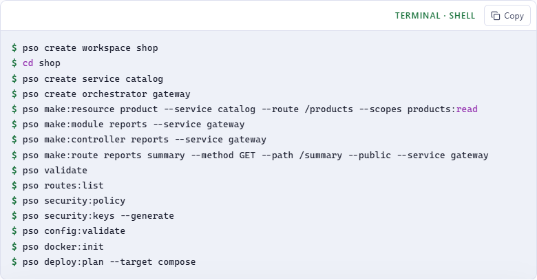

# Quick start

> From an empty folder to a secured two-tier application in a few commands, with the real output of each step and what to do next.

These commands are executed by the documentation test suite, so they are known to work with PSO Web 0.1.0.

This quick start has two checkpoints. **First, declare and inspect the application** with the commands below; this works without starting either service. **Then, run and call it** after configuring the gateway and the Spring service. Keeping those checkpoints separate makes a failed declaration easier to distinguish from a process, database or token problem.

The example creates one protected product route and one public reports route. The product handler is a generated stub that returns an empty list; it does not store products. Follow the [CRUD tutorial](tutorials/crud-api.md) when you need persistence.

```pso-example
pso create workspace shop
cd shop
pso create service catalog
pso create orchestrator gateway
pso make:resource product --service catalog --route /products --scopes products:read
pso make:module reports --service gateway
pso make:controller reports --service gateway
pso make:route reports summary --method GET --path /summary --public --service gateway
pso validate
pso routes:list
pso security:policy
pso security:keys --generate
pso config:validate
pso docker:init
pso deploy:plan --target compose
```



*The screenshot shows how commands appear in the portal. Copy the text block above to run them; the screenshot is a visual aid, not a separate instruction.*

## What each step printed

The blocks below distinguish captured **Verified output** from **Expected output** reconstructed from the command behavior. File lists are abridged, and digests and key ids vary between workspaces; read each block's badge before comparing it with your terminal.

**Workspace**

```text evidence="verified"
$ pso create workspace shop
created    .gitignore
created    README.md
created    pso.workspace.json
```

**Orchestrator and service**

```text evidence="expected"
$ pso create orchestrator gateway
created    package.json
created    src/guards/jwt.guard.ts
created    src/main.ts
created    tsconfig.json
...
registered "gateway" in pso.workspace.json (port 3000)

$ pso create service catalog
created    pom.xml
created    mvnw
created    src/main/java/com/pso/catalog/Application.java
created    src/main/java/com/pso/catalog/routes/PingController.java
created    src/main/resources/application.yml
...
registered "catalog" in pso.workspace.json (port 8081)
```

**The resource: one command, both sides**

```text evidence="expected"
$ pso make:resource product --service catalog --route /products --scopes products:read
created    gateway/src/contracts/product.contract.json
created    catalog/src/main/java/com/pso/catalog/contracts/ProductDto.java
created    catalog/src/main/java/com/pso/catalog/routes/ProductController.java
created    catalog/src/main/resources/contracts/product.contract.json
created    catalog/src/test/java/com/pso/catalog/routes/ProductControllerTests.java
created    docs/api/product.md
created    gateway/src/routes/product/MODULE.pso.ts
created    gateway/src/routes/product/ROUTES.pso.ts
created    gateway/src/routes/product/product.controller.ts
```

**Validation and the route table**

```text evidence="expected"
$ pso validate
gateway: 5 resource(s), digest 1ce8bc49aa9c
catalog: 5 resource(s), digest 94045c91b9f4
OK

$ pso routes:list
GET     /products                product.findAll        -> catalog        guard:jwt

$ pso security:policy
default: deny
GET     /products                guarded:jwt scopes=[products:read]  -> catalog
service catalog: deny by default
```

With the extra `reports` module the route table also shows the public route you added:

```text evidence="expected"
GET     /products                product.findAll        -> catalog        guard:jwt
GET     /reports/summary         reports.summary                          public
```

Note the path: the controller prefix is `/reports`, so the action `@Get("/summary")` is reachable at `/reports/summary`.

## What happened, step by step

1. `create workspace` made `shop/pso.workspace.json`, the registry of the system.
2. `create service` generated a Spring Boot service on port 8081 with its own Maven Wrapper, deny-by-default security and a JWT resource server. `create orchestrator` generated the gateway on port 3000.
3. `make:resource` wrote, in one all-or-nothing step, the gateway module (`MODULE.pso.ts`, `ROUTES.pso.ts`, controller), the Spring controller, DTO and tests, a mirrored contract and a documentation page.
4. `make:module`, `make:controller` and `make:route` created a second module whose three files stay in sync.
5. `validate` checked structure, naming, contracts and the module, route and controller consistency.
6. `security:keys --generate` created a signing key pair (verified output: `generated k-20261108-21b1a884 (ES256); private key: keys\k-20261108-21b1a884.private.pem (owner-only ACL applied); public JWKS: keys\jwks.json`). Its ids are specific to the run.
7. `docker:init` wrote Docker files to the workspace. `deploy:plan` then showed the proposed deployment steps without applying them.

The route from a client to the generated product handler has four explicit hand-offs:

| Hand-off | File or command that proves it | What a failure looks like |
|---|---|---|
| Public URL and policy | `gateway/src/routes/product/ROUTES.pso.ts`; `pso routes:list` | An undeclared path is `404`; a missing token is `401` |
| Controller and forwarding | `gateway/src/routes/product/product.controller.ts`; `pso routes:inspect product` | A declared route with an unavailable service is `503` |
| Spring handler and policy | `catalog/.../routes/ProductController.java` | Spring checks the token again and can return `401` or `403` independently |
| Application result | the generated handler returns an empty list | A successful `GET /products` is `200` with `[]`; no database row is created |

The reports route stops at the gateway: it is public because `ROUTES.pso.ts` says so, not merely because the controller has a `@Get` decorator. Compare both rows in `pso security:policy` before changing access rules.

## Directory structure you now have

```tree title="The workspace at the end of the quick start"
shop/
  pso.workspace.json  # generated: updated by every create command
  docs/api/product.md  # generated: by make:resource
  gateway/
    src/routes/product/
      MODULE.pso.ts  # generated
      ROUTES.pso.ts  # generated
      product.controller.ts  # generated
    src/routes/reports/  # manual: the public module
    src/contracts/product.contract.json  # generated
    src/guards/jwt.guard.ts  # generated
  catalog/
    src/main/java/com/pso/catalog/
      routes/  # generated: controllers
      application/  # generated: services
      contracts/  # generated: request and response records
    src/main/resources/application.yml  # generated, plus one application-<profile>.yml per profile
  keys/  # generated by security:keys: index.json, jwks.json and a key pair
  docker-compose.yml  # optional: written by docker:init
  .env.example  # optional: written by docker:init
```

> [!NOTE]
> The generated workspace `.gitignore` starts with `node_modules`, `dist`, `target` and `.pso/`. The first `pso security:keys --generate` appends `keys/*.private.pem` to it (verified), so the private key is not committed by accident. The public files (`jwks.json`, `*.public.pem`, `index.json`) are meant to be committed.

## Run it

Before starting, install the generated gateway dependencies. From the **framework checkout**, run `pso java:install` once so Maven can resolve the local `com.pso` starters, then return to `shop/`. The protected product route also needs the **same issuer, audience and public key** in the gateway and Spring service. [Running the environment](getting-started/running.md) shows the variables; [Build a CRUD API](tutorials/crud-api.md#12-give-both-services-a-way-to-verify-tokens) includes a complete local JWKS server and token script.

```powershell
cd gateway
npm install
cd ..
pso dev
```

`pso dev` needs JWT settings for the guarded routes; see [Running the environment](getting-started/running.md). Open `pso studio` to watch the services live.

Use a second terminal to check the state before sending a request:

```powershell
pso services:health
pso routes:inspect product
```

`services:health` probes running processes; `routes:inspect` reads declarations. A valid route with a stopped service is still a valid route. Once both processes are ready, send a token with `products:read` to `GET /products`. Expect `200` and `[]`; without a token expect `401`. The [first endpoint walkthrough](getting-started/first-endpoint.md) shows full response bodies and the log lines that explain each result.

## If something goes wrong

| What you see | Meaning | Fix |
|---|---|---|
| `error: Invalid route "C:/Program Files/Git/products"` | Git Bash rewrote `/products` | use PowerShell, or `MSYS_NO_PATHCONV=1` |
| `pso validate` prints diagnostics and `FAILED` | a structural rule broke | read the code (`PSO_ROUTE_*`, `PSO_MODULE_*`) in [diagnostics](reference/diagnostics.md) |
| `port 8081 is already in use` (from `pso dev`) | another process holds it | change the port in `pso.workspace.json` or at creation with `--port` |

## Next steps

- [First endpoint](getting-started/first-endpoint.md): requests, responses and logs of what you just built.
- [Running the environment](getting-started/running.md)
- [Your first application](tutorials/first-application.md)
